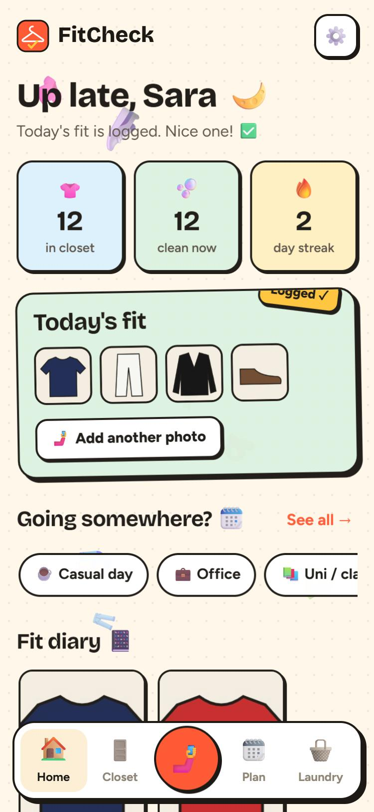
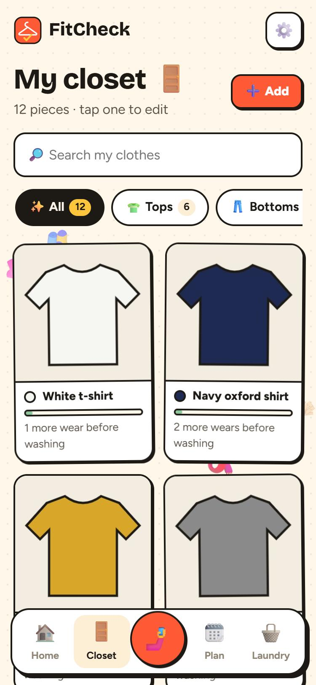
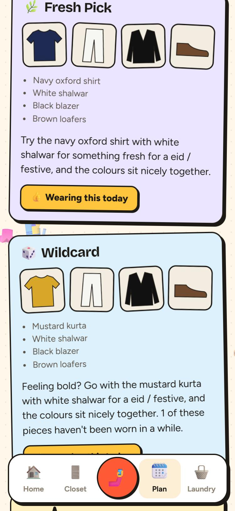

<h1 align="center">FitCheck 👕✨</h1>

<b>Your closet, finally sorted.</b> 
AI closet scanner, daily outfit tracker, event stylist and laundry reminders. 
Made by <b>Maverick Technologies</b>

  <a href="https://fitcheck-wardrobe.vercel.app"><b>🌐 Website</b></a> ·
  <a href="https://fitcheck-closet-app.vercel.app"><b>✨ Open the web app</b></a> ·
  <a href="../../releases/latest"><b>🤖 Download for Android</b></a>

---

## What it does

| | |
|---|---|
| 📸 **Snap your closet once** | Take one photo of your cupboard (messy is fine). The AI finds every shirt, jeans, dress, kurta and shoe, with its colour. |
| 🤳 **One selfie a day** | A quick mirror pic. FitCheck sees what you're wearing and adds one wear to each piece. |
| 🧺 **Laundry reminders** | Each item has its own "wear it X times before washing" number. When it's reached, the item moves to the laundry basket. Tap **Give to laundry**, then **Got it back** when it's clean. |
| 🗓️ **"What do I wear to…?"** | Office, wedding, Eid, date night, gym… pick the occasion and the weather and get 3 outfits made only from clothes that are clean right now. |
| 📔 **Fit diary** | See what you wore each day, and keep your streak going 🔥 |

  
  
  

## ⬇️ Download

**[Download FitCheck.apk](../../releases/latest/download/FitCheck.apk)** from the Releases page (10 MB),
or take [`FitCheck-v1.0.0.apk`](FitCheck-v1.0.0.apk) from this repository,
or just use the **[web app](https://fitcheck-closet-app.vercel.app)** in any browser.

### Install on Android
1. Download the APK on your phone.
2. Tap the file. If Android asks, allow **Install unknown apps** for your browser or file app.
3. Tap **Install**, then open **FitCheck**.
4. Allow the camera (for photos) and notifications (for the daily selfie reminder).

Needs Android 7.0 or newer.

## 🧠 The AI

- **Online:** Google Gemini (or Anthropic Claude) vision reads closet photos and selfies, and plans outfits.
- **Offline / no server:** small models run right on the phone: SegFormer (clothes parsing) for selfies and CLIP for single items, plus a built-in rule-based stylist.

## 🔒 Privacy

No account. Your closet, wear counts and diary stay on your device. Photos are only sent to be analysed and are not stored on a server. You can save and restore a backup from Settings.

---

© Maverick Technologies

